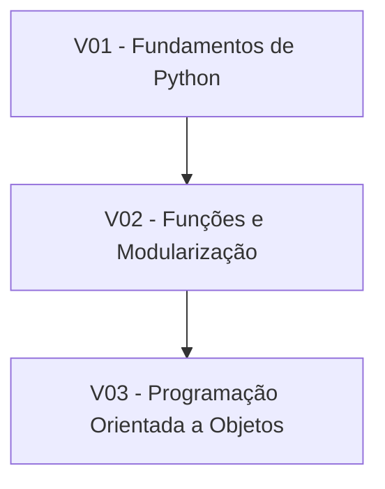

# Sistema Bancário em Python

## Sobre o projeto

Projeto desenvolvido ao longo dos cursos e bootcamps da plataforma Digital Innovation One (DIO), com o objetivo de aplicar progressivamente os conhecimentos adquiridos na linguagem Python e no desenvolvimento de software.

O sistema bancário simula operações de um caixa eletrônico, evoluindo desde uma implementação procedural baseada nos fundamentos da programação até uma aplicação orientada a objetos com persistência de dados.

Cada versão representa uma etapa diferente do processo de aprendizado, demonstrando a evolução da organização do código, da modelagem das entidades e da implementação das regras de negócio.

As versões anteriores são preservadas para documentar essa trajetória de desenvolvimento.

## Status do projeto

🟢 **Concluído — Três versões desenvolvidas dentro do escopo educacional.**

A V03 representa a implementação mais completa do projeto.

## Objetivos

- Consolidar os fundamentos da linguagem Python.
- Desenvolver o raciocínio lógico.
- Implementar regras de negócio.
- Aplicar funções e modularização.
- Trabalhar com estruturas de dados.
- Implementar persistência de dados.
- Aplicar programação orientada a objetos.
- Modelar entidades e relacionamentos.
- Desenvolver soluções reutilizáveis.
- Aplicar boas práticas de desenvolvimento.
- Documentar a evolução técnica do projeto.

## Evolução do projeto

### V01 — Fundamentos de programação

Primeira implementação do sistema bancário, concentrada em um único arquivo Python.

O objetivo principal foi aplicar os fundamentos da linguagem na resolução de um problema prático.

Principais características:

- Programação procedural.
- Variáveis e constantes.
- Estruturas condicionais.
- Estruturas de repetição.
- Depósitos.
- Saques.
- Controle de saldo.
- Limites de saque.
- Extrato bancário.

Os dados são mantidos exclusivamente em memória durante a execução da aplicação.

[Documentação da V01](./v01/README.md)

### V02 — Funções e modularização

Segunda implementação do sistema bancário, introduzindo funções e separação de responsabilidades em diferentes módulos.

Principais características:

- Modularização do código.
- Funções reutilizáveis.
- Argumentos posicionais e nomeados.
- Listas e dicionários.
- Cadastro de usuários.
- Identificação por CPF.
- Gerenciamento de múltiplas contas.
- Manipulação de arquivos.
- Persistência de clientes e contas em JSON.
- Validação de dados cadastrais.
- Tratamento parcial de exceções.

Esta versão representa a evolução de uma aplicação procedural concentrada em um único arquivo para uma implementação modularizada.

O código original foi preservado e necessita de configuração do armazenamento local para execução.

[Documentação da V02](./v02/README.md)

### V03 — Programação orientada a objetos

Terceira implementação do sistema bancário, seguindo a modelagem UML proposta pela DIO.

Principais características:

- Classes e objetos.
- Herança.
- Encapsulamento.
- Polimorfismo.
- Abstração.
- Classes abstratas.
- Composição e associação.
- Métodos de classe.
- Gerenciamento de clientes.
- Gerenciamento de múltiplas contas.
- Modelagem de transações.
- Histórico bancário persistente.
- Controle diário de saques.
- Persistência completa dos dados previstos no projeto em JSON.
- Recuperação dos objetos armazenados.
- Interface interativa organizada em menus.
- Validação funcional e testes de integração locais.

Esta versão integra os conhecimentos adquiridos nas etapas anteriores e representa a implementação final do desafio de programação orientada a objetos.

[Documentação da V03](./v03/README.md)

## Comparativo entre versões

| Funcionalidade                   | V01 | V02     | V03 |
| -------------------------------- | --- | ------- | --- |
| Depósitos                        | ✅  | ✅      | ✅  |
| Saques                           | ✅  | ✅      | ✅  |
| Consulta de saldo                | ✅  | ✅      | ✅  |
| Extrato bancário                 | ✅  | ✅      | ✅  |
| Limite por saque                 | ✅  | ✅      | ✅  |
| Controle da quantidade de saques | ✅  | ✅      | ✅  |
| Controle diário por data         | ❌  | ❌      | ✅  |
| Funções                          | ❌  | ✅      | ✅  |
| Modularização                    | ❌  | ✅      | ✅  |
| Cadastro de clientes             | ❌  | ✅      | ✅  |
| Múltiplas contas                 | ❌  | ✅      | ✅  |
| Persistência JSON                | ❌  | Parcial | ✅  |
| Persistência do histórico        | ❌  | ❌      | ✅  |
| Programação orientada a objetos  | ❌  | ❌      | ✅  |
| Herança                          | ❌  | ❌      | ✅  |
| Encapsulamento                   | ❌  | ❌      | ✅  |
| Polimorfismo                     | ❌  | ❌      | ✅  |
| Abstração                        | ❌  | ❌      | ✅  |
| Classes abstratas                | ❌  | ❌      | ✅  |
| Testes de integração locais      | —   | —       | ✅  |

## Evolução técnica



A evolução do projeto demonstra a aplicação progressiva de conceitos de programação:

**V01:** resolução do problema através de lógica procedural.

**V02:** organização da aplicação através de funções, módulos e persistência inicial.

**V03:** representação das entidades através de objetos, integração das responsabilidades e persistência das operações bancárias.

## Estrutura do projeto

```text
banking-system/
├── README.md
│
├── v01/
│   ├── 01_desafio_cx_eletronico.py
│   └── README.md
│
├── v02/
│   ├── contas.py
│   ├── cx_eletronico.py
│   ├── main.py
│   ├── usuario.py
│   └── README.md
│
└── v03/
    ├── clientes.py
    ├── contas.py
    ├── main.py
    ├── sistema.py
    ├── transacoes.py
    └── README.md
```

Cada versão possui sua própria documentação, contendo funcionalidades, regras de negócio, conceitos aplicados, instruções de execução e limitações.

## Tecnologias utilizadas

- Python
- JSON
- Git
- GitHub
- Visual Studio Code

### Bibliotecas utilizadas ao longo do projeto

- `abc`
- `datetime`
- `json`
- `pathlib`
- `math`

Todas as bibliotecas utilizadas pertencem à biblioteca padrão do Python.

## Como executar

Clone o repositório:

```bash
git clone https://github.com/raffinlearn/dio-studies.git
```

Acesse o diretório do sistema bancário:

```bash
cd dio-studies/projects/banking-system
```

### Executar a V01

```bash
cd v01
python 01_desafio_cx_eletronico.py
```

### Executar a V02

```bash
cd v02
python main.py
```

Antes de executar a V02, consulte sua documentação para configurar o diretório e os arquivos de armazenamento.

### Executar a V03

```bash
cd v03
python main.py
```

A V03 cria automaticamente os arquivos necessários para a persistência dos dados.

Os comandos de execução consideram que o terminal está inicialmente no diretório `banking-system/`.

Para utilizar a implementação mais completa, recomenda-se a V03.

## Validação

A versão final foi validada através de testes funcionais manuais e 12 grupos de testes de integração executados localmente.

As validações contemplaram:

- Cadastro de clientes.
- Criação e associação de contas.
- Depósitos e saques.
- Limites bancários.
- Titularidade das contas.
- Valores inválidos.
- Saldo insuficiente.
- Histórico de transações.
- Renovação do limite diário.

Também foi validada manualmente a recuperação dos dados após o encerramento e a reinicialização da aplicação.

## Aprendizados

O desenvolvimento incremental deste projeto permitiu aplicar diferentes conceitos e paradigmas de programação em um mesmo contexto de negócio.

Entre os principais conhecimentos desenvolvidos estão:

- Lógica de programação.
- Organização e reutilização de código.
- Modelagem de entidades.
- Separação de responsabilidades.
- Implementação de regras de negócio.
- Manipulação e persistência de dados.
- Integração entre componentes.
- Validação de funcionalidades.
- Documentação técnica.
- Controle de versão.

A preservação das diferentes implementações permite comparar abordagens e compreender como novos conhecimentos podem melhorar a organização e a estrutura de uma aplicação.

## Considerações

Este projeto possui finalidade exclusivamente educacional e não foi desenvolvido para utilização em operações financeiras reais.

A implementação utiliza armazenamento local, identificação por CPF sem autenticação e representação monetária com `float`, respeitando o escopo de aprendizado.

Possíveis evoluções futuras incluem bancos de dados relacionais, APIs REST, autenticação, representação monetária com `Decimal` e testes automatizados mais abrangentes.

## Referências

- [Digital Innovation One (DIO)](https://www.dio.me/)
- [Repositório oficial da Trilha Python — DIO](https://github.com/digitalinnovationone/trilha-python-dio)
- [Documentação oficial do Python](https://docs.python.org/pt-br/3/)

## Créditos

O projeto foi desenvolvido com base nos desafios e conteúdos educacionais disponibilizados pela Digital Innovation One (DIO).

As implementações, adaptações e funcionalidades complementares foram desenvolvidas como parte do processo de aprendizado e evolução técnica.
