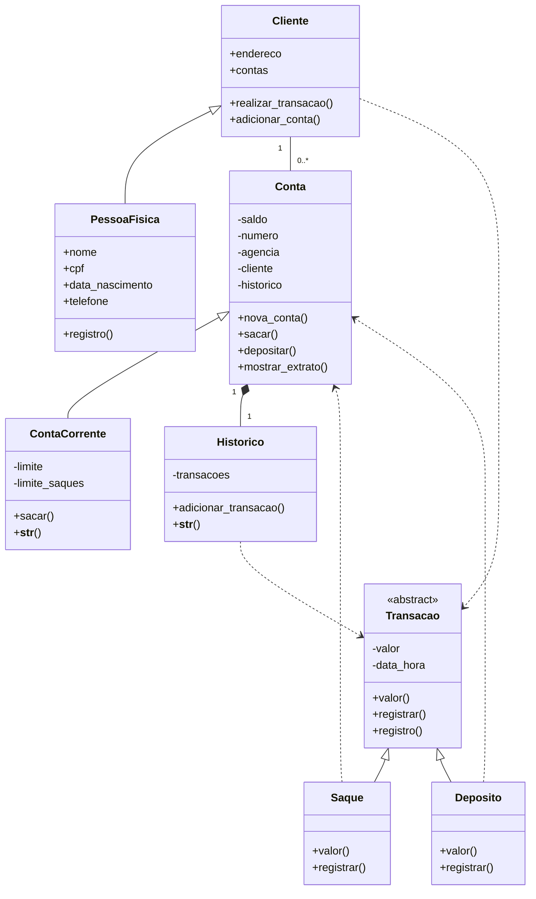

# Sistema Bancário — V03

## Sobre o projeto

Terceira versão do sistema bancário desenvolvido em Python como parte dos desafios de projeto da plataforma Digital Innovation One (DIO).

Esta versão introduz a programação orientada a objetos (POO), seguindo a modelagem UML proposta durante o curso e ampliando a implementação com gerenciamento de múltiplas contas, persistência de dados em arquivos JSON e controle diário de saques.

O sistema simula um caixa eletrônico através de uma interface interativa no terminal, permitindo cadastrar clientes, gerenciar contas correntes e realizar operações bancárias.

## Status do projeto

🟢 **Concluído — Implementação funcional e validada dentro do escopo educacional.**

## Objetivos

- Aplicar os princípios da programação orientada a objetos.
- Implementar a modelagem UML proposta pela DIO.
- Modelar entidades e seus relacionamentos.
- Aplicar herança, encapsulamento, abstração e polimorfismo.
- Desenvolver uma aplicação modular.
- Implementar regras de negócio bancárias.
- Gerenciar clientes e múltiplas contas.
- Persistir e recuperar dados utilizando arquivos JSON.
- Consolidar boas práticas de programação.
- Validar o funcionamento das operações bancárias.

## Funcionalidades

### Gerenciamento de clientes

- Cadastro de clientes pessoa física.
- Cadastro de nome, CPF, data de nascimento, telefone e endereço.
- Identificação de clientes através do CPF.
- Normalização do CPF informado.
- Validação do formato do CPF.
- Prevenção de cadastros duplicados.
- Validação da data de nascimento.
- Recuperação de clientes previamente cadastrados.

### Gerenciamento de contas

- Criação de contas correntes.
- Geração automática e sequencial do número da conta.
- Associação entre cliente e conta bancária.
- Gerenciamento de múltiplas contas por cliente.
- Listagem das contas cadastradas.
- Seleção de contas existentes.
- Verificação da titularidade durante a execução de transações.

### Depósitos

- Realização de depósitos.
- Validação de valores positivos.
- Validação de valores finitos na interface.
- Atualização do saldo bancário.
- Registro da movimentação no histórico.
- Persistência dos dados após a operação.

### Saques

- Realização de saques.
- Validação do valor solicitado.
- Verificação do saldo disponível.
- Controle do limite por operação.
- Controle da quantidade diária de saques.
- Renovação automática do limite em uma nova data.
- Registro das operações bem-sucedidas.
- Persistência dos dados após a operação.

### Extrato bancário

- Consulta das movimentações realizadas.
- Identificação do tipo de transação.
- Exibição da data e hora da movimentação.
- Exibição do valor de cada operação.
- Consulta do saldo atualizado.
- Recuperação das movimentações de sessões anteriores.

### Persistência de dados

- Criação automática do diretório de armazenamento.
- Armazenamento de clientes, contas, saldos e transações em JSON.
- Salvamento após alterações bem-sucedidas.
- Recuperação automática dos dados ao iniciar a aplicação.
- Reconstrução dos objetos a partir dos dados armazenados.
- Preservação do histórico entre diferentes execuções.

## Regras de negócio

| Regra                    | Definição                                             |
| ------------------------ | ----------------------------------------------------- |
| Agência bancária         | 0001                                                  |
| Saldo inicial            | R$ 0,00                                               |
| Identificação do cliente | CPF                                                   |
| Formato do CPF           | 11 dígitos numéricos                                  |
| CPF duplicado            | Não permitido                                         |
| Número da conta          | Sequencial e único no sistema                         |
| Contas por cliente       | Múltiplas contas permitidas                           |
| Valor de depósito        | Maior que zero                                        |
| Valor de saque           | Maior que zero                                        |
| Limite padrão por saque  | R$ 500,00                                             |
| Limite diário padrão     | 3 saques por conta                                    |
| Renovação do limite      | A cada nova data                                      |
| Saldo insuficiente       | Operação não permitida                                |
| Titularidade             | Transações realizadas em contas associadas ao cliente |
| Histórico                | Somente operações bem-sucedidas                       |
| Persistência             | Após alterações realizadas com sucesso                |
| Data de nascimento       | Não pode ser futura                                   |

## Modelagem orientada a objetos

A aplicação utiliza oito classes principais, seguindo a estrutura proposta pela DIO.

### Cliente

Classe base responsável pelo gerenciamento dos clientes.

Atributos:

- Endereço.
- Lista de contas.

Métodos principais:

- `realizar_transacao()`
- `adicionar_conta()`

Responsável por associar contas ao cliente e intermediar a execução das transações.

### PessoaFisica

Especialização da classe `Cliente`.

Atributos:

- Nome.
- CPF.
- Data de nascimento.
- Telefone.
- Endereço herdado.
- Contas herdadas.

Método adicional:

- `registro()`

Responsável por representar os dados cadastrais e disponibilizá-los em formato adequado para persistência.

### Conta

Classe base responsável pelas operações bancárias.

Atributos:

- Saldo.
- Número da conta.
- Agência.
- Cliente titular.
- Histórico.

Métodos principais:

- `nova_conta()`
- `sacar()`
- `depositar()`
- `mostrar_extrato()`

Utiliza propriedades para disponibilizar a consulta dos atributos internos.

O método `nova_conta()` utiliza `@classmethod` para permitir a criação de instâncias da própria classe ou de suas especializações.

### ContaCorrente

Especialização da classe `Conta`.

Atributos adicionais:

- Limite por saque.
- Limite diário de saques.

Sobrescreve o método `sacar()` para aplicar regras específicas da conta corrente e reutiliza a implementação da classe base através de `super()`.

### Historico

Responsável pelo gerenciamento das transações bancárias.

Atributo:

- Lista de transações.

Métodos principais:

- `adicionar_transacao()`
- `__str__()`

Armazena registros de movimentações e disponibiliza sua representação textual para consulta do extrato.

### Transacao

Classe abstrata que estabelece o contrato das transações bancárias.

Atributos:

- Valor.
- Data e hora.

Contrato abstrato:

- Propriedade `valor`.
- Método `registrar()`.

Método adicional:

- `registro()`

Define a estrutura comum das transações e disponibiliza uma representação compatível com JSON.

### Saque

Especialização da classe abstrata `Transacao`.

Responsabilidades:

- Executar a operação de saque.
- Retornar o resultado da operação.
- Registrar a movimentação quando realizada com sucesso.

### Deposito

Especialização da classe abstrata `Transacao`.

Responsabilidades:

- Executar a operação de depósito.
- Retornar o resultado da operação.
- Registrar a movimentação quando realizada com sucesso.

## Diagrama de classes



## Conceitos aplicados

### Programação orientada a objetos

- Classes e objetos.
- Construtores.
- Atributos e métodos de instância.
- Encapsulamento por convenção.
- Propriedades com `@property`.
- Métodos de classe com `@classmethod`.
- Herança.
- Polimorfismo.
- Abstração.
- Classes abstratas com `ABC`.
- Métodos abstratos com `@abstractmethod`.
- Sobrescrita de métodos.
- Composição e associação.
- Utilização de `super()`.
- Métodos especiais como `__str__()`.

### Programação Python

- Modularização.
- Separação de responsabilidades.
- Funções reutilizáveis.
- Classes como argumentos de funções.
- Estruturas condicionais.
- Correspondência de padrões com `match/case`.
- Estruturas de repetição.
- Expressões geradoras.
- List comprehensions.
- Tratamento de exceções.
- Early return.
- Manipulação de strings.
- Manipulação de datas e horários.
- Gerenciadores de contexto.
- Manipulação de arquivos e diretórios.
- Serialização e desserialização JSON.

## Tecnologias utilizadas

- Python 3.10 ou superior
- JSON
- Git
- GitHub
- Visual Studio Code

### Bibliotecas da biblioteca padrão

| Biblioteca | Finalidade                             |
| ---------- | -------------------------------------- |
| `abc`      | Classes e métodos abstratos            |
| `datetime` | Manipulação de datas e horários        |
| `json`     | Serialização e recuperação de dados    |
| `pathlib`  | Gerenciamento de arquivos e diretórios |
| `math`     | Validação de valores numéricos finitos |

O projeto não necessita de bibliotecas externas.

O desenvolvimento e os testes locais foram realizados utilizando Python 3.14.6.

## Estrutura do projeto

```text
v03/
├── clientes.py
├── contas.py
├── main.py
├── sistema.py
├── transacoes.py
└── README.md
```

### Responsabilidades dos módulos

| Arquivo         | Responsabilidade                                    |
| --------------- | --------------------------------------------------- |
| `clientes.py`   | Modelagem dos clientes e pessoas físicas            |
| `contas.py`     | Modelagem das contas e regras bancárias             |
| `transacoes.py` | Classes abstratas, transações e histórico           |
| `sistema.py`    | Persistência, recuperação e gerenciamento dos dados |
| `main.py`       | Interface, menus e integração das funcionalidades   |

## Persistência de dados

Os dados são armazenados localmente em um arquivo JSON.

```text
v03/
└── dados/
    └── banco.json
```

O diretório e o arquivo de armazenamento são criados automaticamente quando necessário.

### Estrutura dos dados

Exemplo ilustrativo utilizando dados fictícios:

```json
[
  {
    "nome": "Cliente Teste",
    "data_nascimento": "1995-05-10",
    "cpf": "00000000000",
    "telefone": "11900000000",
    "endereco": "Rua Teste, 100",
    "contas": [
      {
        "numero": 1,
        "agencia": "0001",
        "saldo": 800.0,
        "historico": [
          {
            "tipo": "Deposito",
            "valor": 1000.0,
            "data_hora": "2026-11-24 10:00:00"
          },
          {
            "tipo": "Saque",
            "valor": 200.0,
            "data_hora": "2026-11-24 10:05:00"
          }
        ]
      }
    ]
  }
]
```

Durante a inicialização, os registros armazenados são recuperados e convertidos novamente em objetos Python.

Os arquivos de dados locais não são versionados pelo Git, evitando a exposição de informações cadastrais.

## Como executar

Clone o repositório:

```bash
git clone https://github.com/raffinlearn/dio-studies.git
```

Acesse o diretório do projeto:

```bash
cd dio-studies/projects/banking-system/v03
```

Execute a aplicação:

```bash
python main.py
```

Não é necessário instalar dependências externas ou criar manualmente os arquivos JSON.

## Interface do sistema

### Menu principal

```text
===================================
          SISTEMA BANCÁRIO
===================================

[1] Cadastrar cliente
[2] Acessar sistema
[0] Encerrar
```

### Menu do cliente

```text
===================================
          MENU DO CLIENTE
===================================

[1] Criar conta corrente
[2] Listar contas
[3] Acessar conta corrente
[0] Voltar
```

### Caixa eletrônico

```text
===================================
           CAIXA ELETRÔNICO
===================================

[1] Depositar
[2] Sacar
[3] Extrato
[0] Voltar
```

## Fluxo da aplicação

1. Inicialização do sistema.
2. Recuperação dos dados armazenados.
3. Cadastro ou identificação do cliente.
4. Criação ou seleção de uma conta corrente.
5. Acesso ao menu de operações bancárias.
6. Execução de depósitos ou saques.
7. Validação das regras de negócio.
8. Atualização do saldo.
9. Registro da movimentação no histórico.
10. Persistência das alterações.
11. Consulta do extrato.
12. Encerramento da aplicação.

## Testes e validação

A implementação foi validada através de testes funcionais manuais e testes de integração locais utilizando `assert`.

| Cenário validado              | Resultado |
| ----------------------------- | --------- |
| Cadastro de cliente           | Aprovado  |
| Criação e associação de conta | Aprovado  |
| Depósito                      | Aprovado  |
| Limite por saque              | Aprovado  |
| Saques válidos                | Aprovado  |
| Limite diário de saques       | Aprovado  |
| Histórico de transações       | Aprovado  |
| Valores inválidos de depósito | Aprovado  |
| Titularidade da conta         | Aprovado  |
| Renovação do limite diário    | Aprovado  |
| Saldo insuficiente            | Aprovado  |
| Valores inválidos de saque    | Aprovado  |

**Resultado: 12 de 12 grupos de testes locais aprovados.**

Também foi realizada a validação manual do fluxo completo da aplicação, incluindo o encerramento, a reinicialização e a recuperação dos dados armazenados.

O script utilizado para os testes de integração foi preservado localmente e não integra os arquivos publicados nesta versão.

## Evolução em relação às versões anteriores

| Característica                  | V01 | V02     | V03 |
| ------------------------------- | --- | ------- | --- |
| Operações bancárias             | Sim | Sim     | Sim |
| Modularização                   | Não | Sim     | Sim |
| Funções                         | Não | Sim     | Sim |
| Cadastro de clientes            | Não | Sim     | Sim |
| Múltiplas contas                | Não | Sim     | Sim |
| Persistência de clientes        | Não | Sim     | Sim |
| Persistência do saldo           | Não | Parcial | Sim |
| Persistência do histórico       | Não | Não     | Sim |
| Programação orientada a objetos | Não | Não     | Sim |
| Herança                         | Não | Não     | Sim |
| Encapsulamento                  | Não | Não     | Sim |
| Classes abstratas               | Não | Não     | Sim |
| Polimorfismo                    | Não | Não     | Sim |
| Controle diário por data        | Não | Não     | Sim |

## Limitações e possíveis melhorias

Por se tratar de um projeto educacional, algumas características de sistemas bancários reais não fazem parte do escopo desta versão.

Possíveis evoluções:

- Utilização de `Decimal` para representação monetária.
- Autenticação e autorização de clientes.
- Validação completa dos dígitos verificadores do CPF.
- Tratamento de arquivos JSON corrompidos.
- Aprimoramento do encapsulamento durante a recuperação dos objetos.
- Validações adicionais diretamente nas entidades.
- Persistência em bancos de dados relacionais.
- Desenvolvimento de uma API REST.
- Implementação de transferências bancárias.
- Testes automatizados com frameworks especializados.

Essas melhorias não são necessárias para a conclusão do desafio atual.

## Referências

- [Digital Innovation One (DIO)](https://www.dio.me/)
- [Repositório oficial da Trilha Python — DIO](https://github.com/digitalinnovationone/trilha-python-dio)
- [Documentação oficial do Python](https://docs.python.org/pt-br/3/)

## Conclusão

Esta versão representa a consolidação dos conhecimentos de programação orientada a objetos aplicados ao desenvolvimento de uma aplicação bancária.

A implementação demonstra a evolução das versões anteriores, integrando modelagem de entidades, regras de negócio, modularização, persistência de dados e interação com o usuário.

O projeto foi concluído dentro do escopo educacional proposto, servindo como base para estudos futuros de desenvolvimento backend, bancos de dados e APIs REST.
